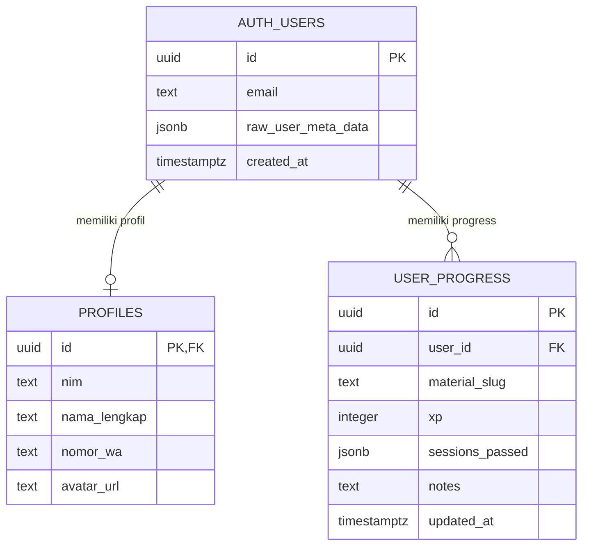

# siDeutsch — Entity Relationship Diagram

## Diagram

## Tabel dan Relasi

| Tabel | Kolom yang digunakan aplikasi | Constraint / catatan |
| --- | --- | --- |
| `auth.users` | `id`, `email`, `raw_user_meta_data`, `created_at` | Tabel yang dikelola Supabase Auth. NIM mahasiswa dipakai untuk membentuk email login sintetis. |
| `public.profiles` | `id`, `nim`, `nama_lengkap`, `nomor_wa`, `avatar_url` | Field yang dipilih/ditulis aplikasi. Kode memakai `id = auth.users.id` dan upsert berdasarkan `id`, sehingga relasi dimaksudkan 1:1. DDL lengkap `profiles` tidak tersedia dalam repo; cocokkan dengan Supabase aktual sebelum migrasi. |
| `public.user_progress` | `id`, `user_id`, `material_slug`, `xp`, `sessions_passed`, `notes`, `updated_at` | UUID primary key; `user_id` mereferensikan `auth.users(id)` dengan `ON DELETE CASCADE`; pasangan `(user_id, material_slug)` unik. RLS membatasi akses user ke baris miliknya. |

### Kardinalitas

- Satu `auth.users` memiliki nol atau satu baris `profiles`; profil diidentifikasi dengan UUID auth yang sama. FK profil perlu dikonfirmasi pada schema Supabase aktual karena DDL lengkap `profiles` tidak tersedia di repo.
- Satu `auth.users` dapat memiliki banyak baris `user_progress` (satu per materi yang dipelajari).
- Constraint unik `(user_id, material_slug)` menjaga maksimal satu progress per materi untuk setiap user.
- `material_slug` mengacu secara logis ke ID di Astro Content Collection `materi`, bukan ke tabel relasional Supabase.

### Bentuk Data Progress

- `xp`: XP yang didapat pada materi tersebut.
- `sessions_passed`: JSONB array nomor sesi, misalnya `[1, 2]`.
- `notes`: catatan belajar user untuk materi tersebut.
- `updated_at`: diisi helper upsert setiap perubahan.

Level dashboard dihitung dari `sessions_passed` dan metadata CEFR materi di collection. File `supabase/profile_current_level.sql` menambahkan kolom legacy `profiles.current_level`, tetapi interface profil dan alur level aktif tidak membacanya.

## Data Konten dan Storage

- Kosakata, kalimat konteks, dan terjemahan konteks disimpan di Astro Content Collection Markdown, bukan di tabel database. `contextIndonesian` opsional dan hanya untuk UI terjemahan kalimat.
- Avatar disimpan di Supabase Storage bucket `avatars`; `profiles.avatar_url` menyimpan URL yang dipakai aplikasi. Metadata objek Storage tidak dimodelkan sebagai relasi SQL aplikasi di diagram ini.
