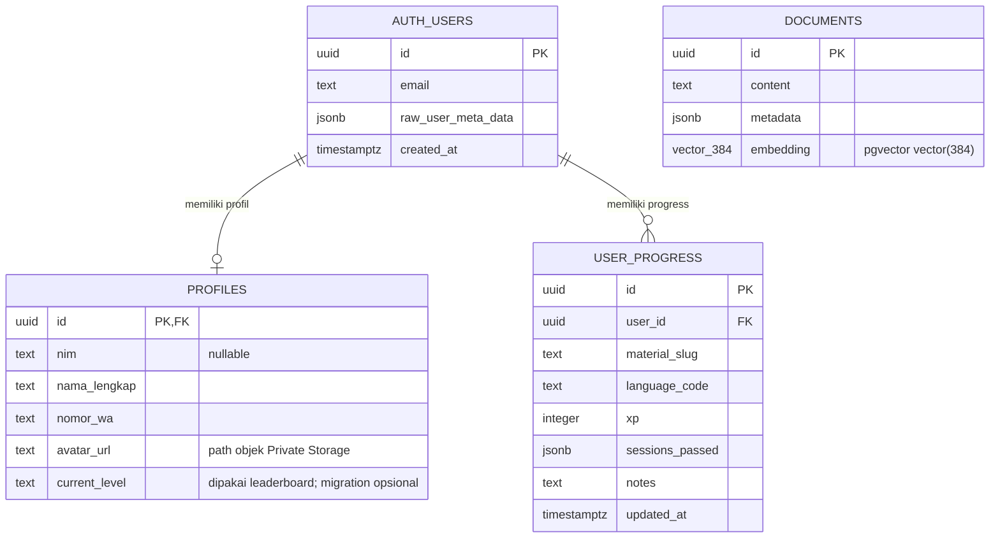

# NdUniverse — Entity Relationship Diagram

NdUniverse V4 mencakup modul German dan English. Skema progress mendukung `language_code` untuk German (`de`) dan English (`en`) agar progress kedua modul tetap terpisah.

## Entitas Utama

## Tabel Database

| Tabel | Kolom yang digunakan aplikasi | Constraint / catatan |
| --- | --- | --- |
| `auth.users` | `id`, `email`, `raw_user_meta_data`, `created_at` | Dikelola Supabase Auth. Login menerima email atau NIM lama yang dinormalisasi ke email akun. |
| `public.profiles` | `id`, `nim`, `nama_lengkap`, `nomor_wa`, `avatar_url`, `current_level` | `id` sama dengan `auth.users.id`. `nim` bersifat **nullable** karena pengguna email umum tidak selalu memiliki NIM. `avatar_url` menyimpan path objek, bukan URL publik. `supabase/profile_current_level.sql` menambahkan `current_level`; dashboard menghitung levelnya sendiri dari progress, sedangkan leaderboard memakai kolom ini dan menampilkan `A1` jika nilainya kosong. |
| `public.user_progress` | `id`, `user_id`, `material_slug`, `language_code`, `xp`, `sessions_passed`, `notes`, `updated_at` | Kombinasi `(user_id, material_slug, language_code)` unik untuk memisahkan progress `de` dan `en`; `sessions_passed` harus JSON array melalui check JSONB; `xp` tidak boleh negatif; RLS membatasi akses ke pemilik baris. |
| `public.documents` | `id`, `content`, `metadata`, `embedding` | Satu baris per potongan materi RAG. `embedding` bertipe pgvector `vector(384)` dari Cloudflare Workers AI; index HNSW memakai cosine distance. `metadata` menyimpan `source_file`, `language`, `content_hash`, `chunk_index`, dan `chunk_count`. |

## Relasi dan Makna Kolom

- Satu pengguna Supabase memiliki nol atau satu profil.
- Satu pengguna dapat memiliki banyak baris progress, satu baris per `material_slug`.
- Kolom `language_code` bernilai `de` atau `en` agar progress Jerman dan Inggris tetap terpisah.
- Akses tanpa login dihapus; seluruh fitur pembelajaran dan progress wajib digunakan setelah login.
- `material_slug` mengacu logis ke ID Astro Content Collection dan bukan foreign key SQL.
- `xp` menyimpan progres XP kumulatif yang sudah dikomit.
- `notes` menyimpan catatan belajar pengguna untuk materi tertentu.
- `updated_at` diperbarui setiap upsert progress.
- Dashboard pencapaian EN/DE membaca `xp` dan `sessions_passed` untuk membentuk progress bar serta sisa XP. Persentase diturunkan dari jumlah pilar unik yang lulus dibagi empat; batas XP UI dihitung dari jumlah vocab × 4 pilar × 10 XP per jawaban benar. Nilai persentase dan batas XP ini bukan kolom database baru.
- Level dashboard tidak berasal dari satu kolom database; dihitung dari material CEFR yang telah menyelesaikan keempat pilar.
- Leaderboard berbeda dari level dashboard: RPC `public.get_leaderboard()` menjumlahkan seluruh `user_progress.xp` per pengguna, lalu mengurutkan `profiles.current_level DESC, total XP DESC` dan membatasi hasil ke 100 pengguna.
- Jalankan `supabase/leaderboard.sql` pada project Supabase setelah tabel `user_progress` dan kolom `profiles.current_level` tersedia. RPC memakai `SECURITY DEFINER` dengan `search_path` terbatas, hanya mengembalikan ID/nama/level/XP, dan hak eksekusinya dicabut dari `public`, `anon`, serta `authenticated`; hanya `service_role` yang dapat memanggilnya.
- `documents` berdiri sendiri dan tidak memiliki foreign key ke `auth.users`, `profiles`, atau `user_progress`. Setiap baris mewakili satu chunk konten, dan `metadata.source_file` merujuk secara logis ke file Markdown sumber (bukan relasi SQL).
- RPC `public.match_documents` membandingkan embedding query dengan `documents.embedding` dan mengembalikan chunk serta skor kemiripan. Endpoint chatbot saat ini memakai ambang 0.35 dan maksimal tiga hasil.
- Embedding `documents.embedding` harus berukuran 384 dimensi agar sesuai dengan model Cloudflare Workers AI `@cf/baai/bge-small-en-v1.5`.

## Format `sessions_passed`

Kolom JSONB mendukung dua format:

- Format terbaru mencatat sesi dan pilar secara terpisah, misalnya `["s1-reading", "s1-listening", "s2-writing"]`. Nilai memakai pola `s{nomor-sesi}-{reading|listening|writing|speaking}`.
- Format terdahulu dapat berisi nama pilar (`["reading", "listening", "writing", "speaking"]`) atau angka sesi (`[1, 2, 3, 4]`).

Data lama dinormalisasi saat dibaca untuk kompatibilitas. Nilai sesi-pilar baru menunjukkan bahwa pasangan tersebut telah diselesaikan; nilai ini dipakai untuk indikator progres, bukan untuk memberikan atau menolak akses ke kuis. Kuis tidak mensyaratkan sesi atau pilar sebelumnya.

Upsert menggabungkan kunci progres yang sudah tersimpan dengan kunci baru tanpa mengganti progres sesi-pilar lain. Materi Fachdeutsch dan Career tidak dihitung sebagai poin level CEFR meskipun progress pilar tersimpan.

## Data di Luar Database

- Konten materi dan vocab disimpan dalam Markdown/Astro Content Collections, bukan tabel SQL. Salinan terpotong dan embedding untuk pencarian chatbot disimpan terpisah pada `public.documents`.
- Konten Career German disimpan di `src/modules/german/content/career/*.md` dan diambil melalui koleksi Astro `career`, bukan Supabase.
- Setiap file Career berisi **50 entri `vocab`** dengan `german`, `indonesian`, dan `context`, serta **10 entri `boss_questions`**.
- Setiap `boss_questions` berisi satu `question` berbahasa Jerman dan array `keywords` 2–3 kata kunci untuk penilaian wawancara.
- Bookmark kosakata disimpan di browser pada `localStorage` key `nduniverse-bookmarks` dan tidak disinkronkan ke Supabase.
- Status kelulusan Mock Exam disimpan pada `localStorage` key `nduniverse-ujian-[level]`.
- Status kelulusan Simulasi Goethe disimpan pada `localStorage` key `nduniverse-goethe-[level]`.
- **Sertifikat PDF adalah artefak client-side** yang dibuat melalui `html2pdf.js`; sertifikat tidak disimpan sebagai entitas atau blob database.
- Avatar disimpan di bucket Private `avatars` pada Supabase Storage. Aplikasi membuat Signed URL untuk ditampilkan. Bookmark dan sertifikat tidak memiliki tabel SQL.
- MP3 TTS berbasis hash dan audio statis yang dipetakan melalui manifest disajikan dari jsDelivr. `manifest-cdn.json` memetakan path audio statis; voice line Boss Fight memakai `manifest-boss.json`.
- Generator Microsoft Edge TTS membaca sumber lokal dan memeriksa file output lokal saat dry-run; ia tidak melakukan HTTP/HEAD ke jsDelivr untuk audit ketersediaan. Aset MP3 yang dipublikasikan di-host pada repository `nandayudhistirawibowo/nduniverse-audio`.

## RLS dan Keamanan

`user_progress` mengaktifkan Row Level Security. Pengguna hanya dapat membaca dan mengubah baris milik `auth.uid()` melalui kebijakan select, insert, dan update. Leaderboard tidak membuka akses baca langsung ke seluruh baris progress: agregasi dilakukan oleh RPC yang hanya dapat dipanggil server memakai service role, dan route leaderboard tetap memerlukan autentikasi. Bucket avatar bersifat Private; akses file memerlukan pemeriksaan kepemilikan/admin dan Signed URL. `documents` mengaktifkan RLS; operasi ingest menggunakan service role server-side, bukan kunci service role pada browser.
