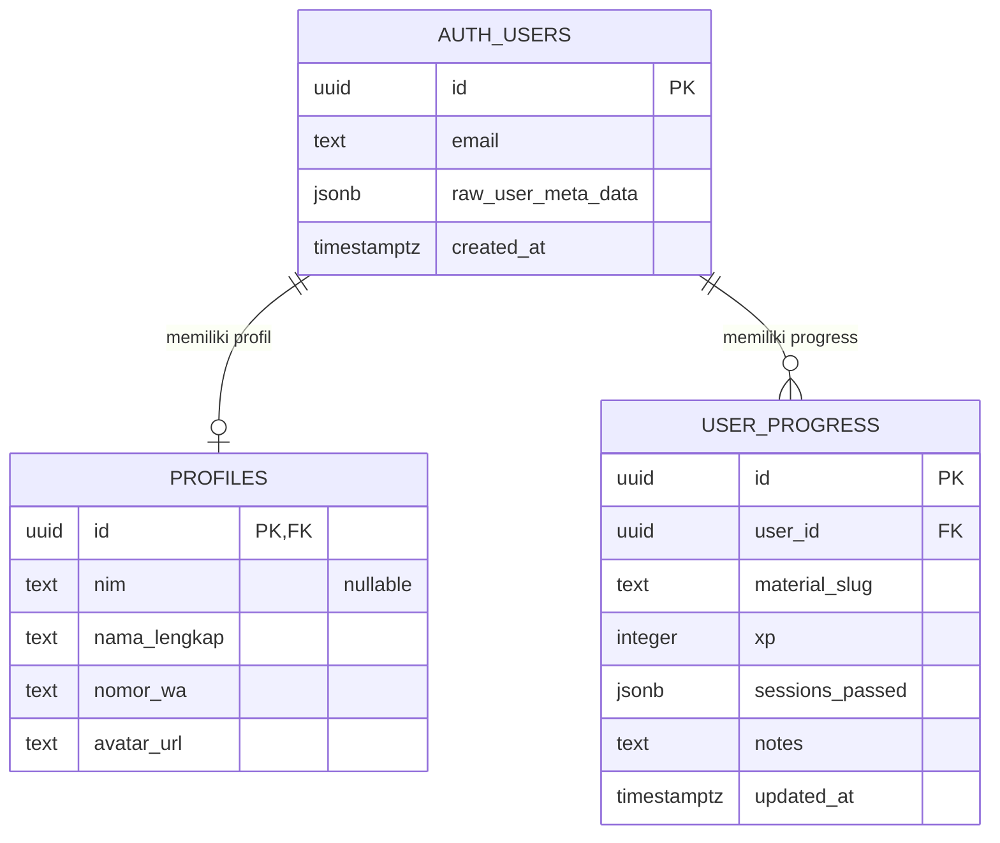

# siDeutsch — Entity Relationship Diagram

## Entitas Relasional

Fitur Bookmark menggunakan `localStorage` di sisi klien, bukan tabel relasional di Supabase.

## Tabel

| Tabel | Kolom yang digunakan aplikasi | Constraint / catatan |
| --- | --- | --- |
| `auth.users` | `id`, `email`, `raw_user_meta_data`, `created_at` | Dikelola Supabase Auth. Pengguna masuk dengan email atau NIM lama yang dipetakan ke alamat `NIM@student.sideutsch.com`; pengguna baru dapat dibuat lewat auto-signup. |
| `public.profiles` | `id`, `nim`, `nama_lengkap`, `nomor_wa`, `avatar_url` | Kolom `nim` nullable (boleh `NULL`) untuk mengakomodasi pengguna umum tanpa NIM. Aplikasi mengupsert profil memakai `id = auth.users.id`. Terapkan `supabase/profiles_nim_nullable.sql` pada database yang kolomnya masih `NOT NULL`, setelah mencocokkan schema aktual. |
| `public.user_progress` | `id`, `user_id`, `material_slug`, `xp`, `sessions_passed`, `notes`, `updated_at` | Didefinisikan di `supabase/user_progress.sql`; `(user_id, material_slug)` unik, FK ke `auth.users(id)` dengan cascade delete, dan RLS membatasi akses ke pemilik baris. |

## Relasi dan Makna Data

- Satu `auth.users` memiliki nol atau satu profil dengan UUID yang sama; DDL lengkap `profiles` tidak tersedia di repo, sehingga detail FK profil perlu dicocokkan dengan Supabase aktual.
- Satu pengguna dapat memiliki banyak baris `user_progress`, satu per slug materi.
- `material_slug` mengacu secara logis pada ID content collection Astro; ia bukan FK ke tabel materi PostgreSQL.
- `xp` adalah nilai kumulatif per materi yang disimpan setelah kuis selesai.
- `sessions_passed` adalah array JSONB nomor sesi yang lulus, misalnya `[1, 2]`.
- `notes` menyimpan catatan belajar per materi dan `updated_at` diperbarui saat upsert.
- Level dashboard dihitung dari sesi lulus dan metadata level CEFR di materi, bukan dari kolom database `current_level`.
- `supabase/profile_current_level.sql` menambahkan kolom legacy `profiles.current_level`; level dashboard saat ini tidak membacanya.

## Data di Luar ERD

- Materi Alltagsdeutsch dan Fachdeutsch berada di `src/content/materi/`; track Career berada di `src/content/career/`. Vocab dan konteks disimpan sebagai Markdown.
- Bookmark memuat `german`, `indonesian`, dan `context` di `localStorage` dengan key `sideutsch-bookmarks`. Bookmark bersifat client-side per browser, tidak disinkronkan dengan Supabase, dan tidak memiliki relasi SQL.
- Avatar disimpan di Supabase Storage bucket `avatars`; `profiles.avatar_url` menyimpan URL yang digunakan aplikasi. Metadata objek Storage tidak dimodelkan sebagai tabel relasional aplikasi.
