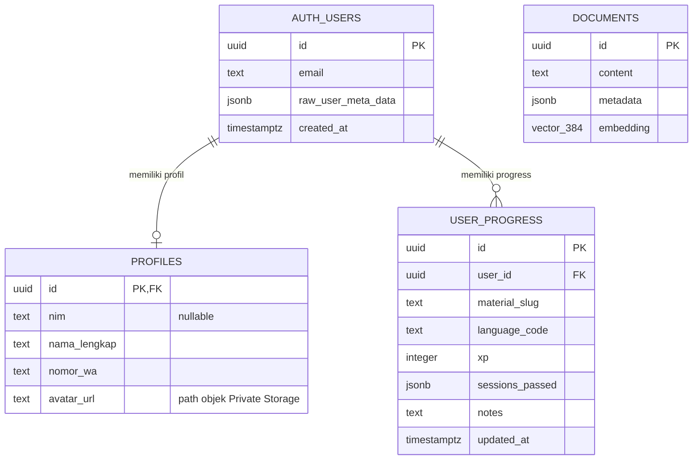

# NdUniverse — Entity Relationship Diagram

NdUniverse V4 mencakup modul German dan English. Skema progress mendukung `language_code` untuk German (`de`) dan English (`en`) agar progress kedua modul tetap terpisah.

## Entitas Utama

## Tabel Database

| Tabel | Kolom yang digunakan aplikasi | Constraint / catatan |
| --- | --- | --- |
| `auth.users` | `id`, `email`, `raw_user_meta_data`, `created_at` | Dikelola Supabase Auth. Login menerima email atau NIM lama yang dinormalisasi ke email akun. |
| `public.profiles` | `id`, `nim`, `nama_lengkap`, `nomor_wa`, `avatar_url` | `id` sama dengan `auth.users.id`. `nim` bersifat **nullable** karena pengguna email umum tidak selalu memiliki NIM. `avatar_url` menyimpan path objek, bukan URL publik. |
| `public.user_progress` | `id`, `user_id`, `material_slug`, `language_code`, `xp`, `sessions_passed`, `notes`, `updated_at` | Kombinasi `(user_id, material_slug, language_code)` unik untuk memisahkan progress `de` dan `en`; `sessions_passed` harus JSON array melalui check JSONB; `xp` tidak boleh negatif; RLS membatasi akses ke pemilik baris. |
| `public.documents` | `id`, `content`, `metadata`, `embedding` | Potongan materi untuk RAG. `embedding` bertipe `vector(384)` dari Cloudflare Workers AI; index HNSW memakai cosine distance. `metadata` menyimpan `source_file`, `language`, `content_hash`, `chunk_index`, dan `chunk_count`. |

## Relasi dan Makna Kolom

- Satu pengguna Supabase memiliki nol atau satu profil.
- Satu pengguna dapat memiliki banyak baris progress, satu baris per `material_slug`.
- Kolom `language_code` bernilai `de` atau `en` agar progress Jerman dan Inggris tetap terpisah.
- Akses tanpa login dihapus; seluruh fitur pembelajaran dan progress wajib digunakan setelah login.
- `material_slug` mengacu logis ke ID Astro Content Collection dan bukan foreign key SQL.
- `xp` menyimpan progres XP kumulatif yang sudah dikomit.
- `notes` menyimpan catatan belajar pengguna untuk materi tertentu.
- `updated_at` diperbarui setiap upsert progress.
- Level dashboard tidak berasal dari satu kolom database; dihitung dari material CEFR yang telah menyelesaikan keempat pilar.
- `documents` berdiri sendiri dan tidak memiliki foreign key ke `auth.users`, `profiles`, atau `user_progress`. Setiap baris mewakili satu chunk konten, dan `metadata.source_file` merujuk secara logis ke file Markdown sumber (bukan relasi SQL).
- RPC `public.match_documents` membandingkan embedding query dengan `documents.embedding` dan mengembalikan chunk serta skor kemiripan. Endpoint chatbot saat ini memakai ambang 0.35 dan maksimal tiga hasil.

## Format `sessions_passed`

Kolom JSONB mendukung dua format:

- Format baru: `['reading', 'listening', 'writing', 'speaking']`
- Format lama: `[1, 2, 3, 4]`

Data lama wajib dinormalisasi saat dibaca menjadi nama pilar. Data lama lengkap `[1, 2, 3, 4]` diperlakukan sebagai keempat pilar lulus. Saat upsert, array yang dikirim dapat berupa string pilar JSONB yang kompatibel dengan PostgreSQL/Supabase tanpa mengubah tipe kolom.

Materi baru dianggap lulus hanya jika keempat pilar ada setelah normalisasi. Materi Fachdeutsch dan Career tidak dihitung sebagai poin level CEFR meskipun progress pilar tersimpan.

## Data di Luar Database

- Konten materi dan vocab disimpan dalam Markdown/Astro Content Collections, bukan tabel SQL. Salinan terpotong dan embedding untuk pencarian chatbot disimpan terpisah pada `public.documents`.
- Konten Career German disimpan di `src/modules/german/content/career/*.md` dan diambil melalui koleksi Astro `career`, bukan Supabase.
- Setiap file Career berisi **50 entri `vocab`** dengan `german`, `indonesian`, dan `context`, serta **10 entri `boss_questions`**.
- Setiap `boss_questions` berisi satu `question` berbahasa Jerman dan array `keywords` 2–3 kata kunci untuk penilaian wawancara.
- Bookmark kosakata disimpan di browser pada `localStorage` key `nduniverse-bookmarks` dan tidak disinkronkan ke Supabase.
- Status kelulusan Mock Exam disimpan pada `localStorage` key `nduniverse-ujian-[level]`.
- Status kelulusan Simulasi Goethe disimpan pada `localStorage` key `nduniverse-goethe-[level]`.
- **Sertifikat PDF adalah artefak client-side** yang dibuat melalui `html2pdf.js`; sertifikat tidak disimpan sebagai entitas atau blob database.
- Avatar disimpan di bucket Private `avatars` pada Supabase Storage. Aplikasi membuat Signed URL untuk ditampilkan. Bookmark dan sertifikat tidak memiliki tabel SQL.
- Aset audio dan manifest yang dikonfigurasi sebagai CDN disajikan melalui jsDelivr; `manifest-cdn.json` di root repository tetap merupakan aset deployment.

## RLS dan Keamanan

`user_progress` mengaktifkan Row Level Security. Pengguna hanya dapat membaca dan mengubah baris milik `auth.uid()` melalui kebijakan select, insert, dan update. Bucket avatar bersifat Private; akses file memerlukan pemeriksaan kepemilikan/admin dan Signed URL. `documents` mengaktifkan RLS; operasi ingest menggunakan service role server-side, bukan kunci service role pada browser.
