# NdUniverse — Alur Aplikasi

## Status Modul

NdUniverse V4 mencakup modul belajar German dan English, chatbot RAG, progress, dan ujian. Pengguna wajib login untuk mengakses dashboard dan fitur pembelajaran. Antarmuka menggunakan Bahasa Indonesia hardcoded; bahasa materi mengikuti modul.

## Alur Utama

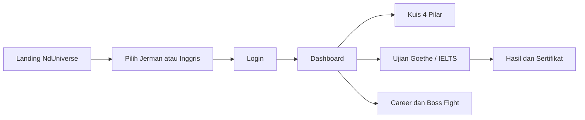

## Login dan Auto-Signup

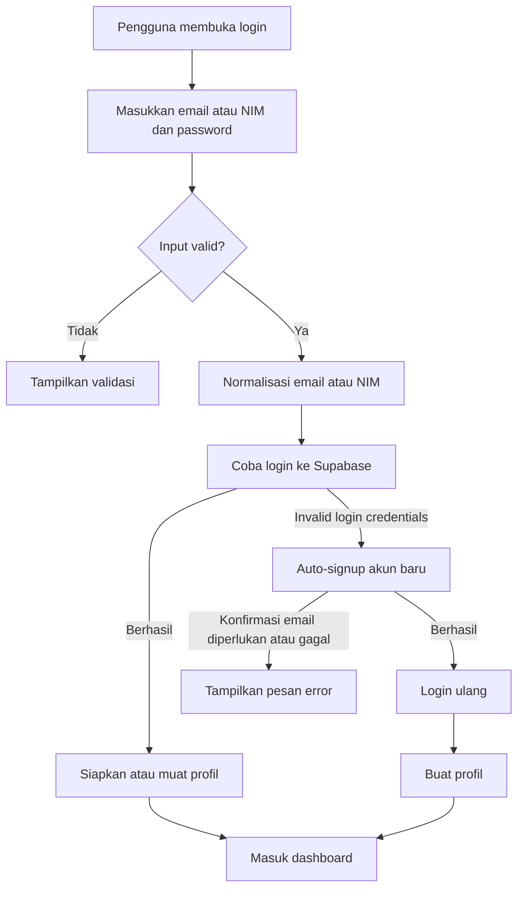

## Alur Ujian Inggris

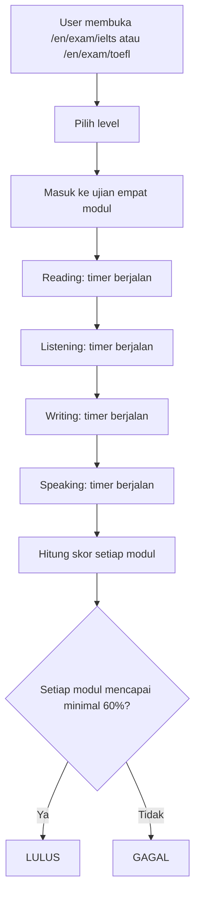

## Alur Detail Materi dan Pilihan Pilar

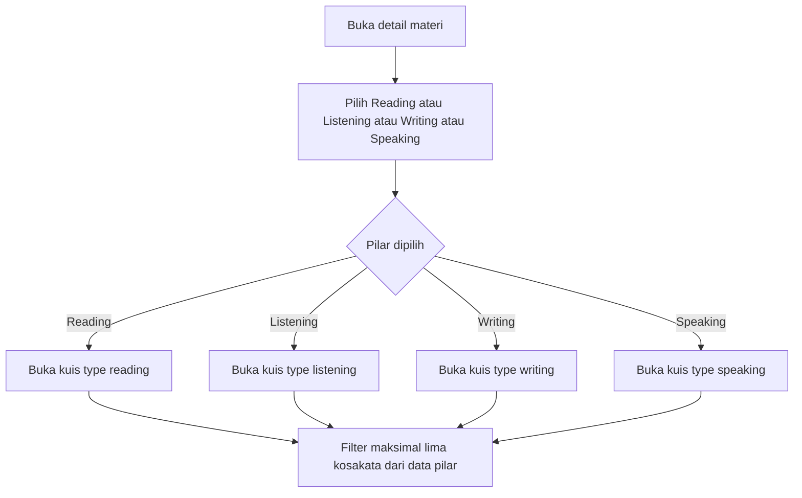

## Alur Kuis 4 Pilar

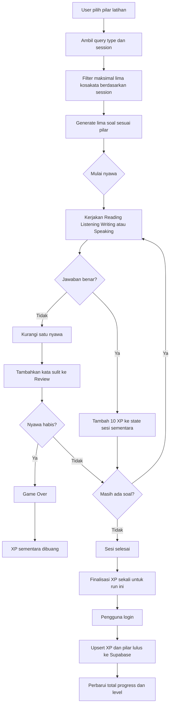

Reading memakai teks dan pilihan ganda; Listening memakai audio/TTS dan pilihan ganda; Writing memakai text box fuzzy matching; Speaking memakai microphone atau text box. Anti-farming membuang XP sementara saat Game Over dan menggunakan guard finalisasi run agar XP tidak dikomit dua kali.

## Pemilihan Sesi dan Pilar Kuis

```mermaid
flowchart TD
    A[Buka detail materi] --> B[Pilih sesi yang tersedia]
    B --> C[Pilih Reading, Listening, Writing, atau Speaking]
    C --> D[Buka URL dengan session dan type]
    D --> E[Ambil batch sesi dan data pilar]
    E --> F[Kerjakan kuis]
    F --> G{Kuis lulus?}
    G -->|Belum| H[Ulangi atau kembali ke materi]
    G -->|Ya| I[Simpan kunci s{session}-{pillar}]
    I --> J[Perbarui indikator progres]
    J --> K[Kembali ke materi]
```

Sesi dan pilar tidak memerlukan progres sebelumnya, tidak memiliki urutan wajib, dan dapat dibuka langsung melalui URL. Kunci progres hanya menandai pasangan sesi-pilar yang telah selesai; tombol setelah kuis kembali ke materi, bukan memaksa kuis berikutnya.

## Chatbot RAG

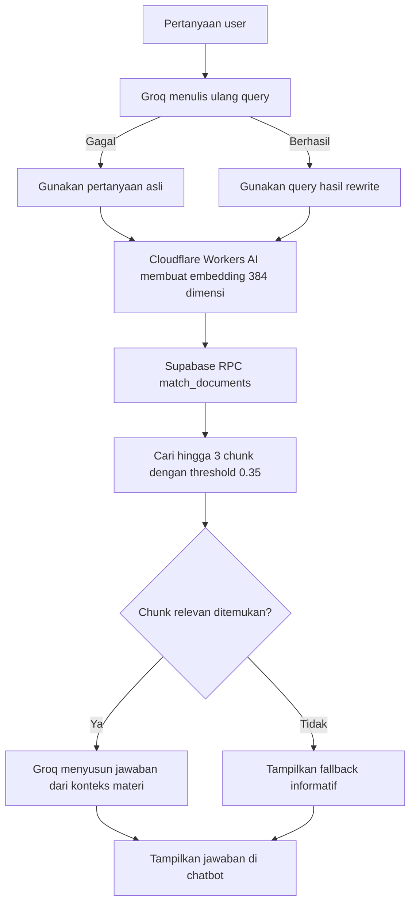

Materi Markdown diindeks ke `public.documents` melalui script ingest. Pembaruan indeks adalah proses manual dan ingest penuh mengganti seluruh baris tabel tersebut.

## Anti-Cheat Fullscreen (NdBot)

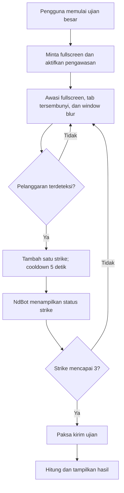

Anti-cheat dipakai oleh ujian besar. Strike ketiga memicu submit paksa; NdBot menampilkan tingkat pelanggaran. Jika browser menolak fullscreen, ujian tetap dapat berjalan sesuai dukungan browser.

## Sinkronisasi `sessions_passed`

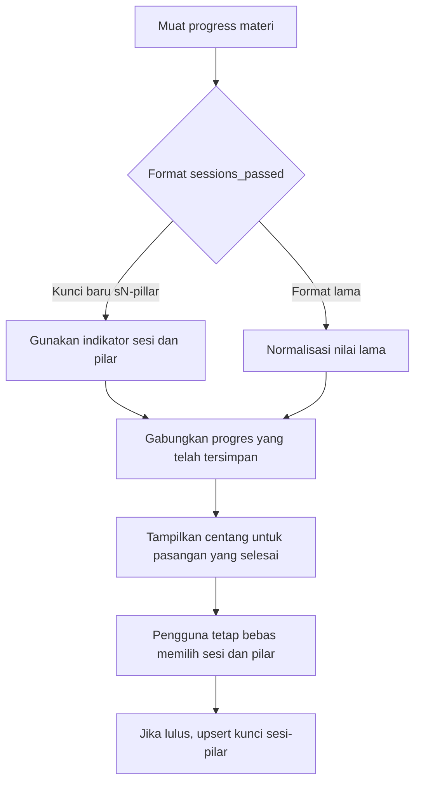

## Alur Career dan Boss Fight Visual Novel

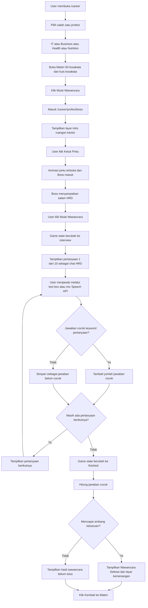

Data Career diambil dari Markdown pada `src/content/career/*.md`. Pertanyaan disimpan pada `boss_questions` dan jawaban dinilai berdasarkan `keywords` dari pertanyaan aktif. Boss Fight tidak menyimpan progress ke Supabase; badge dan hasil ditampilkan state-side di browser.

## Alur Mock Exam 22 Soal

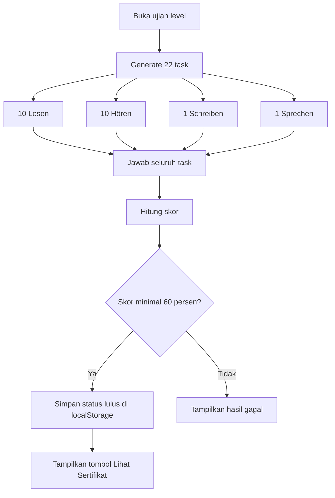

## Alur Simulasi Goethe-Zertifikat

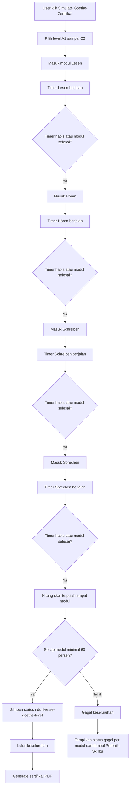

Timer dibatasi sesuai konfigurasi level. Hasil menunjukkan skor, rating, feedback Lesen, transkrip Hören, serta kata kunci Writing/Speaking. Semua modul wajib mencapai 60%.

## Alur TTS

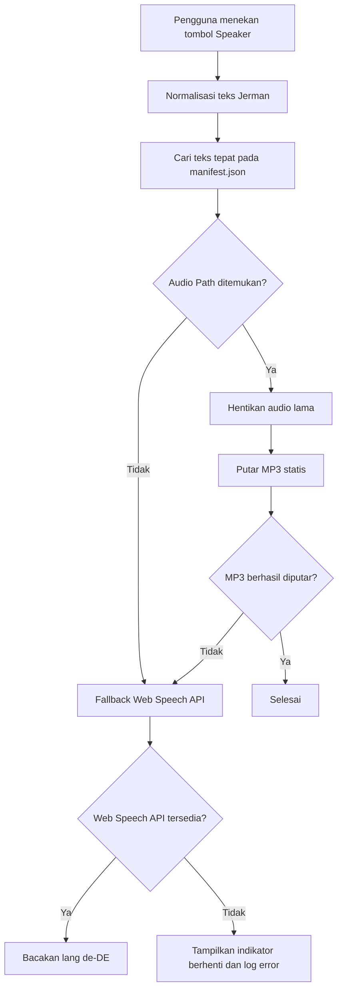

Lookup manifest memakai teks yang dikirim, bukan nama atau pencocokan substring. Manifest dan aset audio yang dikonfigurasi untuk CDN diambil dari jsDelivr; jika manifest atau audio gagal, browser memakai Web Speech API dengan `lang = 'de-DE'`.

## Alur Bookmark


Bookmark tidak disinkronkan ke Supabase dan dihapus/ditampilkan dari browser yang sama.

## Alur Sertifikat Goethe

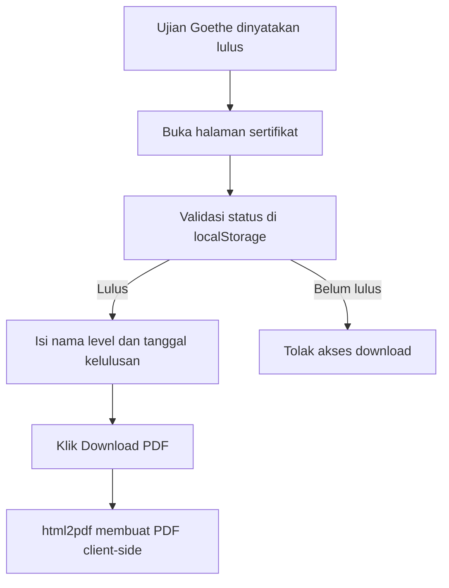
