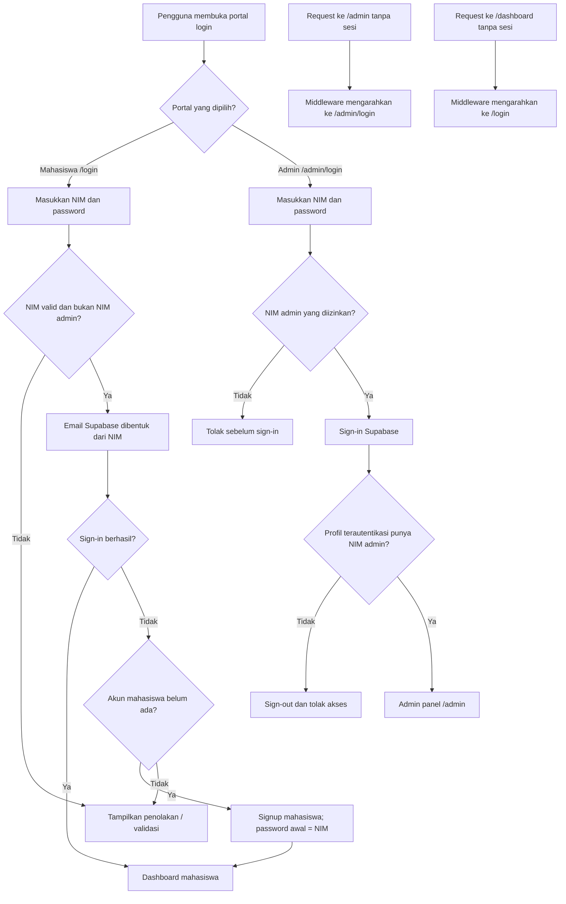
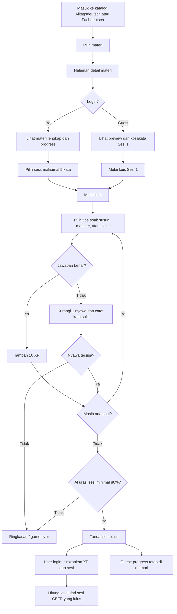
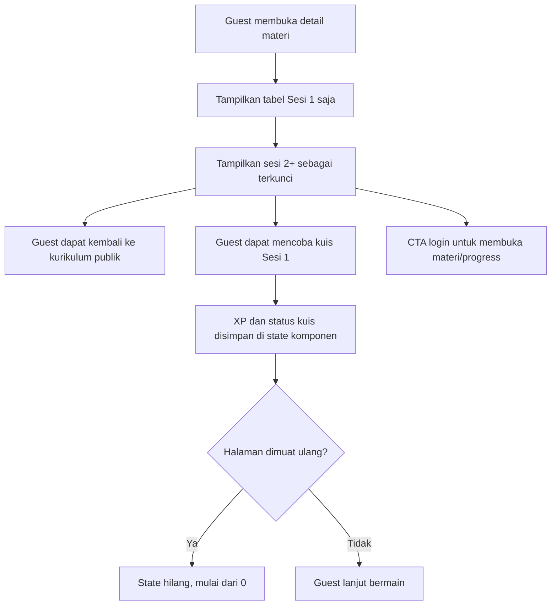
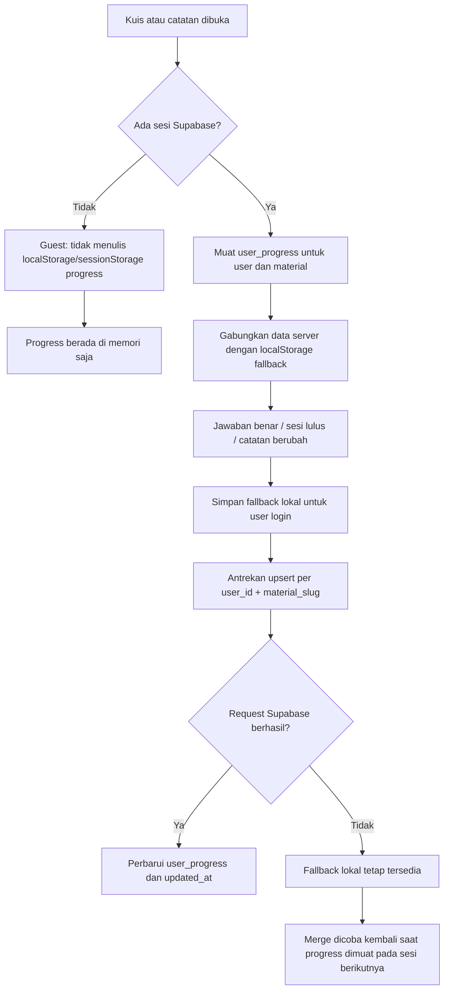
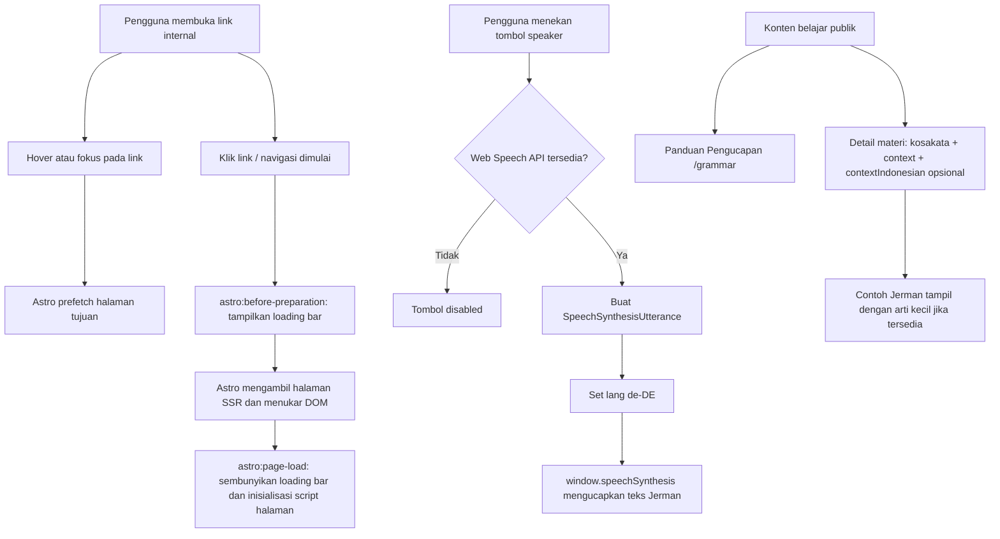

# siDeutsch — Alur Aplikasi

## Login Mahasiswa dan Admin

NIM admin di helper saat ini adalah `admin` dan `000000`. Otorisasi admin dilakukan kembali di middleware dan Admin API; path login terpisah bukan pengganti pemeriksaan hak akses.

## Alur Belajar dan Kuis

## Guest Mode

## Sinkronisasi Progress Supabase

`user_progress.sessions_passed` disimpan sebagai array JSONB nomor sesi, `xp` per materi, dan `notes` per materi. RLS membatasi baris ke pemilik berdasarkan `auth.uid() = user_id`.

## Navigasi, TTS, dan Konten Publik

Prefetch menggunakan strategi hover/focus dan membantu menghangatkan halaman internal, tetapi tidak menjamin SSR selesai sebelum klik. TTS menggunakan voice Jerman yang tersedia di browser/OS; tombol dimatikan jika Web Speech API tidak didukung.
