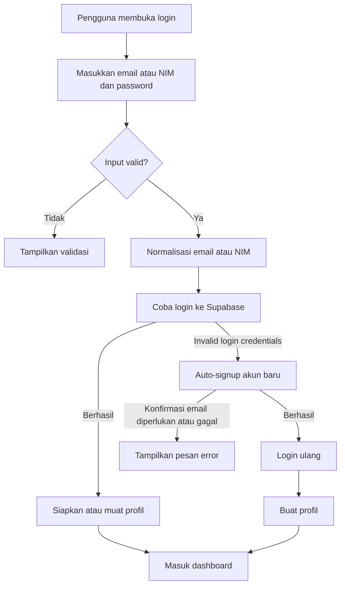
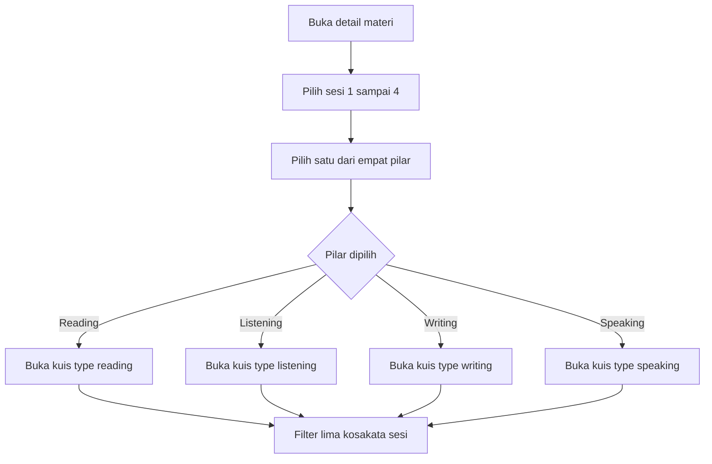
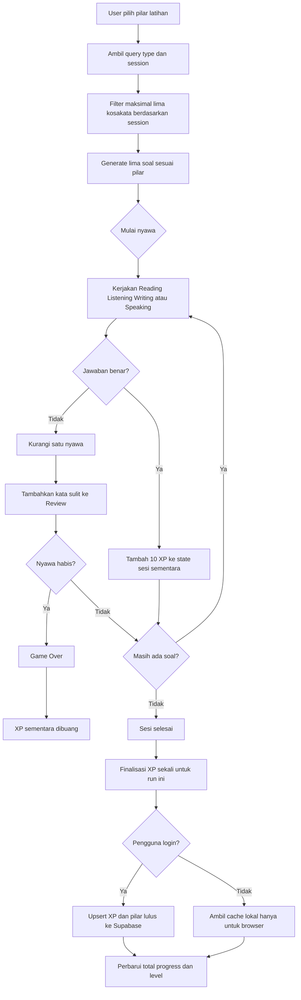
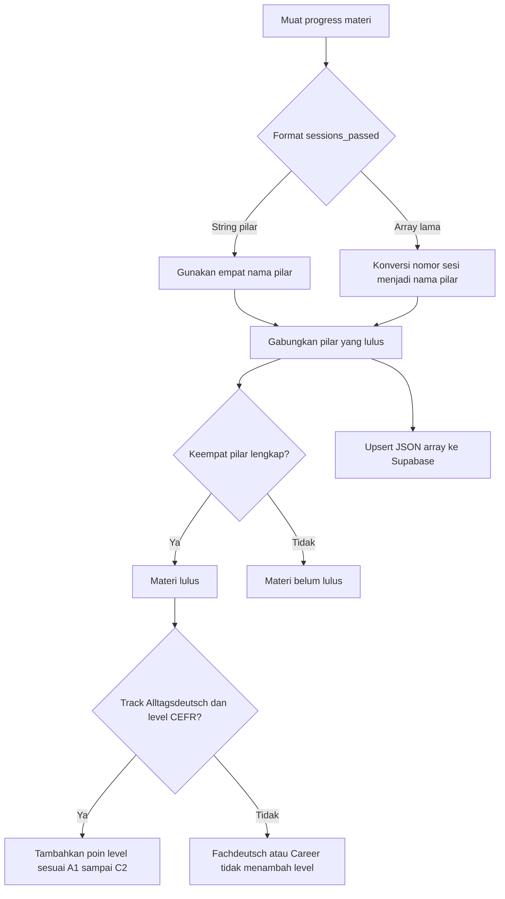
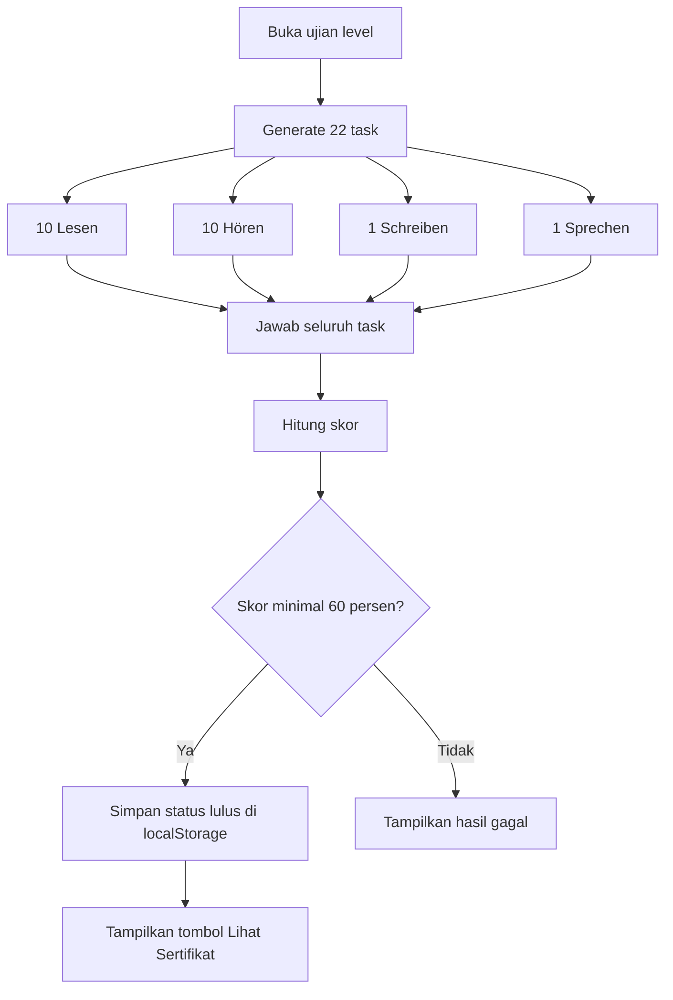
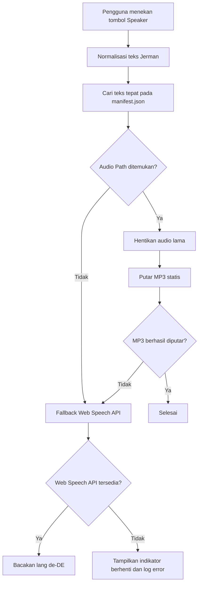
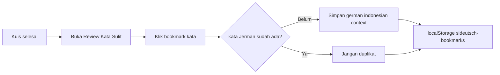
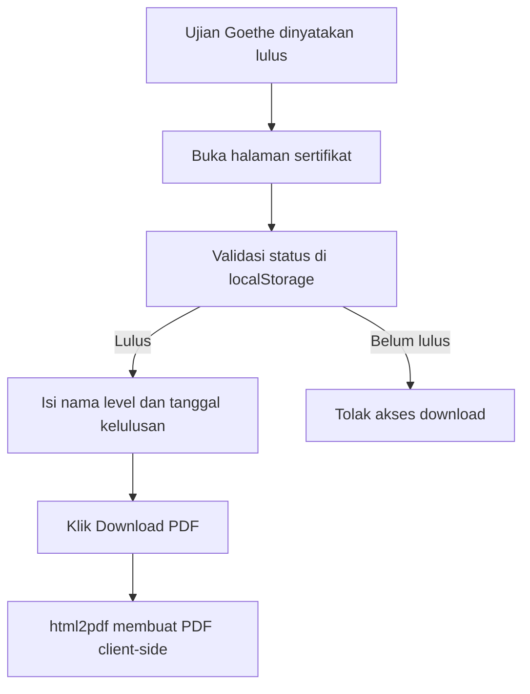

# siDeutsch — Alur Aplikasi

## Login dan Auto-Signup

## Alur Detail Materi dan Pilihan Pilar

## Alur Kuis 4 Pilar

Reading memakai teks dan pilihan ganda; Listening memakai audio/TTS dan pilihan ganda; Writing memakai text box fuzzy matching; Speaking memakai microphone atau text box. Anti-farming membuang XP sementara saat Game Over dan menggunakan guard finalisasi run agar XP tidak dikomit dua kali.

## Sinkronisasi `sessions_passed`

## Alur Mock Exam 22 Soal

## Alur Simulasi Goethe-Zertifikat

Timer dibatasi sesuai konfigurasi level. Hasil menunjukkan skor, rating, feedback Lesen, transkrip Hören, serta kata kunci Writing/Speaking. Semua modul wajib mencapai 60%.

## Alur TTS

Lookup manifest memakai teks yang dikirim, bukan nama atau pencocokan substring. File MP3 berada di `public/audio/tts/`; jika manifest atau audio gagal, browser memakai Web Speech API dengan `lang = 'de-DE'`.

## Alur Bookmark

Bookmark tidak disinkronkan ke Supabase dan dihapus/ditampilkan dari browser yang sama.

## Alur Sertifikat Goethe

