# NdUniverse — Alur Aplikasi

## Status Modul

NdUniverse V4 mencakup modul belajar German dan English, chatbot RAG, progress, dan ujian. Pengguna wajib login untuk mengakses dashboard dan fitur pembelajaran. Antarmuka menggunakan Bahasa Indonesia hardcoded; bahasa materi mengikuti modul.

## Alur Utama

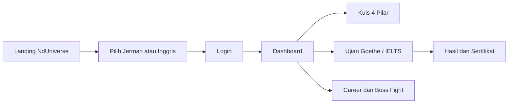

## Login dan Auto-Signup

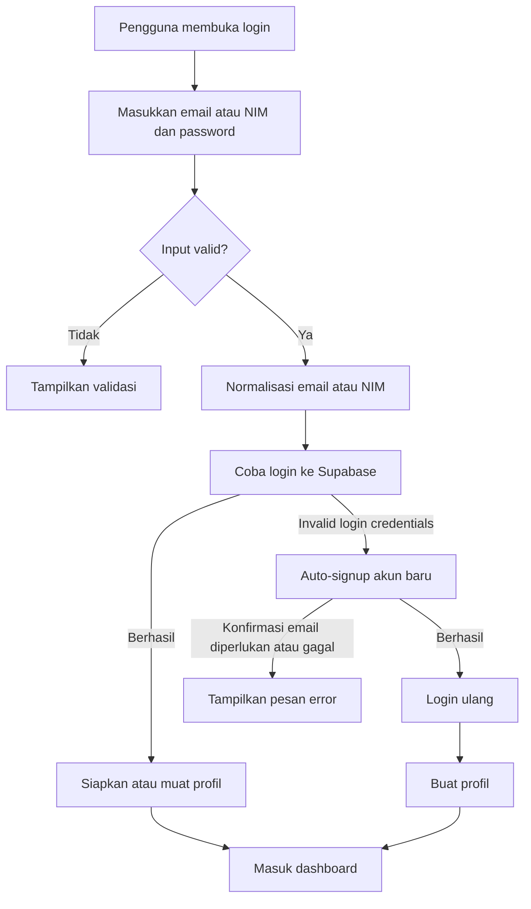

## Alur Ujian Inggris

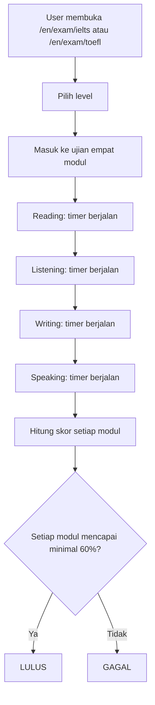

## Alur Detail Materi dan Pilihan Pilar

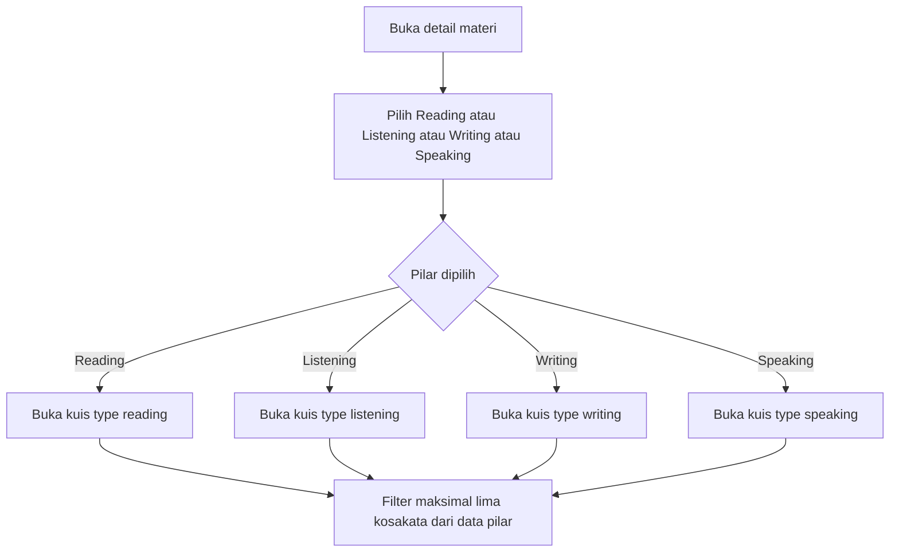

## Alur Kuis 4 Pilar (Tanpa Locking)

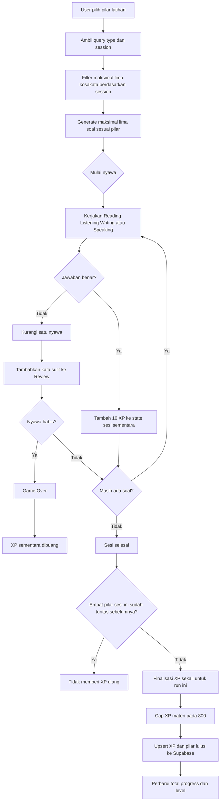

Standar materi adalah 4 sesi × 5 kosakata. Jawaban benar bernilai 10 XP, maksimal 50 XP per pilar dan 200 XP per sesi, dengan batas 800 XP per materi. Reading memakai teks dan pilihan ganda; Listening memakai audio/TTS dan pilihan ganda; Writing memakai text box fuzzy matching; Speaking memakai microphone atau text box. XP sementara dibuang saat Game Over, run hanya difinalisasi sekali, dan pengulangan sesi yang seluruh empat pilarnya sudah selesai tidak memberi XP tambahan.

## Pemilihan Sesi dan Pilar Kuis

```mermaid
flowchart TD
    A[Buka detail materi] --> B[Pilih sesi yang tersedia]
    B --> C[Pilih Reading, Listening, Writing, atau Speaking]
    C --> D[Buka URL dengan session dan type]
    D --> E[Ambil batch sesi dan data pilar]
    E --> F[Kerjakan kuis]
    F --> G{Kuis lulus?}
    G -->|Belum| H[Ulangi atau kembali ke materi]
    G -->|Ya| I[Simpan kunci s{session}-{pillar}]
    I --> J[Perbarui indikator progres]
    J --> K[Kembali ke materi]
```

Sesi dan pilar tidak memerlukan progres sebelumnya, tidak memiliki urutan wajib/locking, dan dapat dibuka langsung melalui URL. Kunci progres hanya menandai pasangan sesi-pilar yang telah selesai; tombol setelah kuis kembali ke materi, bukan memaksa kuis berikutnya.

## NdBot v2 — Chatbot RAG

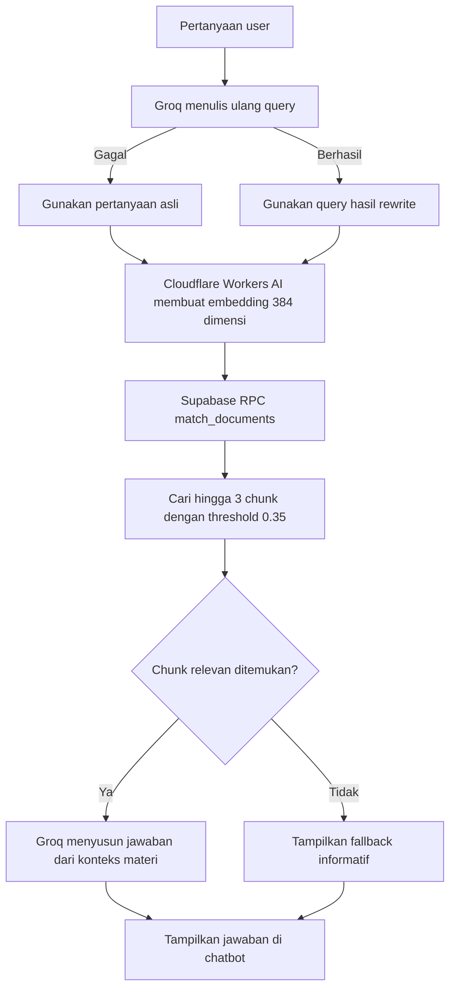

Materi Markdown diindeks ke `public.documents` melalui script ingest. Pembaruan indeks adalah proses manual dan ingest penuh mengganti seluruh baris tabel tersebut.

## Anti-Cheat Fullscreen (NdBot v2 — 3 Strikes)

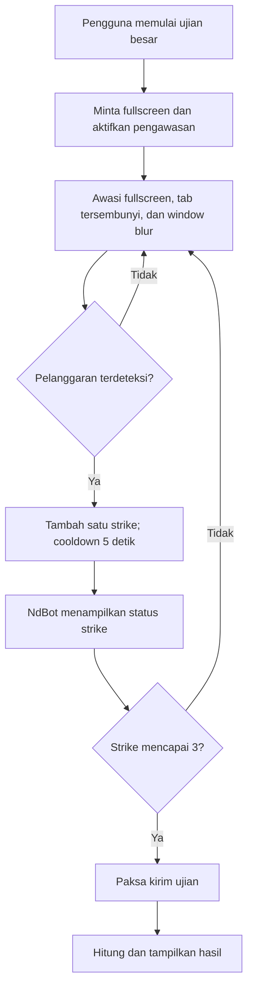

Anti-cheat dipakai oleh ujian besar. Strike ketiga memicu submit paksa; NdBot menampilkan tingkat pelanggaran. Jika browser menolak fullscreen, ujian tetap dapat berjalan sesuai dukungan browser.

## Sinkronisasi `sessions_passed`

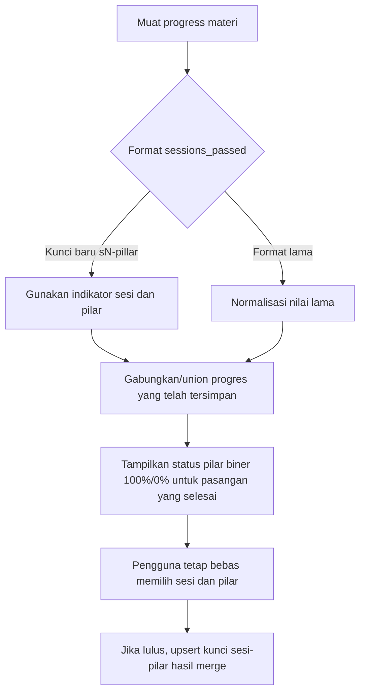

## Progress Pencapaian Dashboard EN/DE

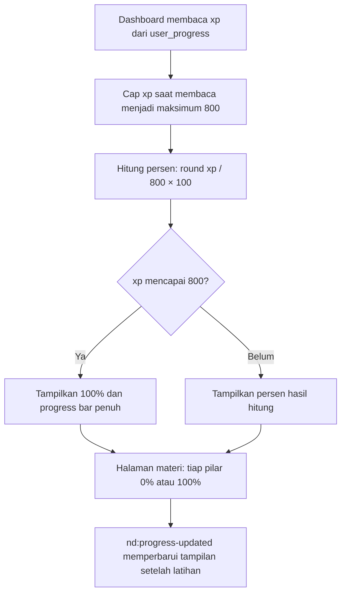

Nilai dashboard/katalog memakai kolom `user_progress.xp` yang di-cap 800, lalu menghitung `Math.round((currentXp / 800) * 100)`. Model kurikulum standar menghasilkan 800 XP dari 4 sesi × 5 kosakata × 4 pilar × 10 XP. XP dicap oleh aplikasi/UI; schema DB tidak memiliki constraint maksimum 800. Sebagian materi Academic English yang masih memiliki 17–19 kosakata merupakan pengecualian konten dan belum mencapai cap melalui materi tersebut.

## Input Kuis/Ujian dan Filter Katalog

- Enter pada text box jawaban menjalankan aksi periksa/kirim/lanjut dengan validasi yang sama seperti tombol; Enter pada textarea mencegah baris baru, sedangkan Shift+Enter tetap membuat baris baru.
- Dropdown level katalog memfilter kartu langsung tanpa reload. `Semua Level` menampilkan semua kartu; nilai A1–C2 dicocokkan case-insensitive setelah normalisasi.
## Grading Artikel dan Fuzzy Matching

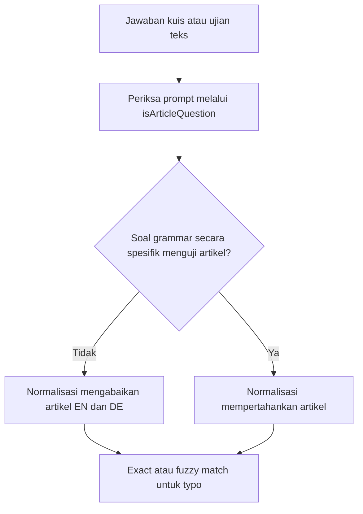

Entri artikel `the/a/an` dan `der/die/das` telah dihapus dari daftar kosakata materi; artikel tetap digunakan pada prompt grammar yang memang mengujinya.

## Alur Career dan Boss Fight Visual Novel

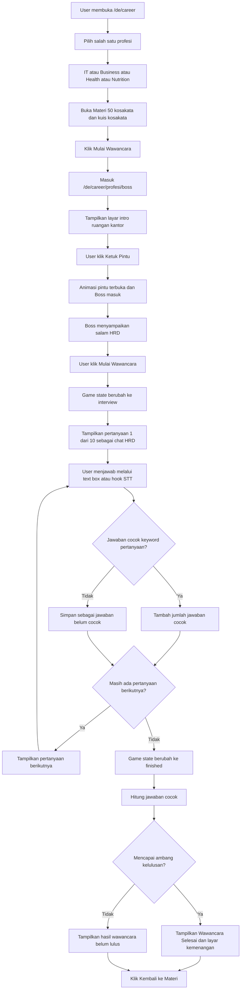

Data Career German diambil dari Markdown pada `src/modules/german/content/career/*.md` melalui Astro Content Collection `career`. Pertanyaan disimpan pada `boss_questions` dan jawaban dinilai berdasarkan `keywords` dari pertanyaan aktif. Boss Fight juga tersedia di `/en/career/[profesi]/boss` dengan data English pada `src/modules/english/content/career/`. Hasil wawancara ditampilkan di browser; progress Boss Fight tidak disimpan ke Supabase.

Mic Boss Fight hanya menangkap jawaban peserta melalui hook STT. Audio dialog HRD tetap diputar terpisah oleh `boss-audio.js` dan sinkronisasi typewriter tidak memakai alur transkripsi.

## Alur Speech-to-Text

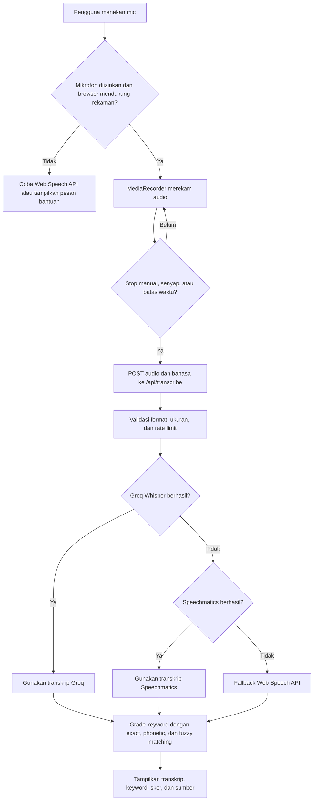

Sebelum merekam, browser meminta `noiseSuppression`, `echoCancellation`, dan `autoGainControl`. Filter band-pass memakai high-pass 80 Hz dan low-pass 8 kHz. Pre-roll buffer 1.500 ms merekam audio sebelum VAD aktif agar awal ucapan tidak terpotong; dynamic VAD mengukur noise floor dan memakai hangover 800 ms untuk kata tunggal atau 2.000 ms untuk kalimat. Engine memakai locale `en-US` atau `de-DE` sesuai route. Endpoint membatasi ukuran audio hingga 10 MB dan permintaan hingga 30 per IP per menit. Setelah feedback, kuis melanjutkan pertanyaan berikutnya sesuai alur komponennya.

## Alur Leaderboard

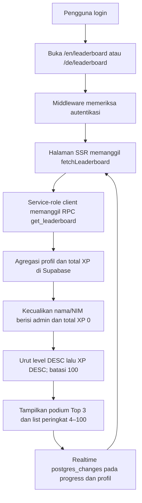

RPC didefinisikan di `supabase/leaderboard.sql`, mengecualikan nama/NIM yang mengandung `admin` tanpa membedakan kapitalisasi serta pengguna dengan XP 0, dan mengembalikan hanya ID/nama/level/XP. SQL memberi grant execute ke `anon`, `authenticated`, dan `service_role`; aplikasi memanggil RPC server-side menggunakan service-role client. Jalankan SQL tersebut pada Supabase sebelum memakai halaman leaderboard.

## Alur Mock Exam 22 Soal

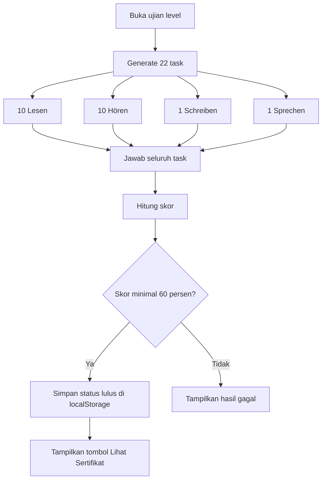

## Alur Simulasi Goethe-Zertifikat

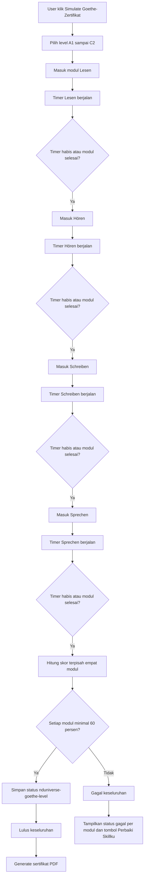

Timer dibatasi sesuai konfigurasi level. Hasil menunjukkan skor, rating, feedback Lesen, transkrip Hören, serta kata kunci Writing/Speaking. Semua modul wajib mencapai 60%.

## Alur TTS

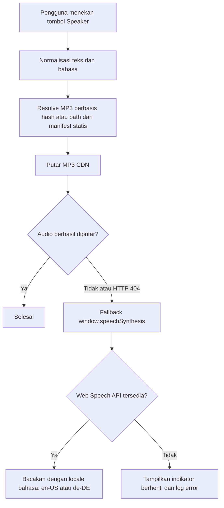

Audio dibuat dengan Microsoft Edge TTS dan di-host di repository `nduniverse-audio`, disajikan melalui jsDelivr. TTS English UK memakai `en-GB`. Jalur pemeriksaan generator menggunakan file lokal, bukan request HTTP/HEAD ke CDN. Fallback Web Speech berlaku pada pemutar TTS shared; Boss Fight memakai player voice-line tersendiri.

## Alur Bookmark

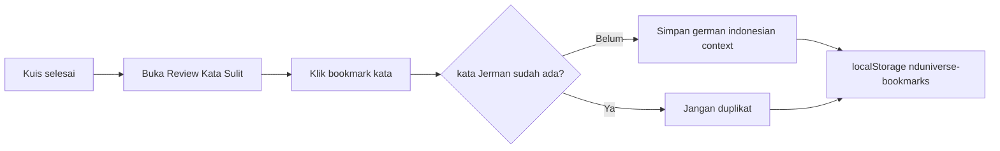

Bookmark tidak disinkronkan ke Supabase dan dihapus/ditampilkan dari browser yang sama.

## Alur Sertifikat Goethe

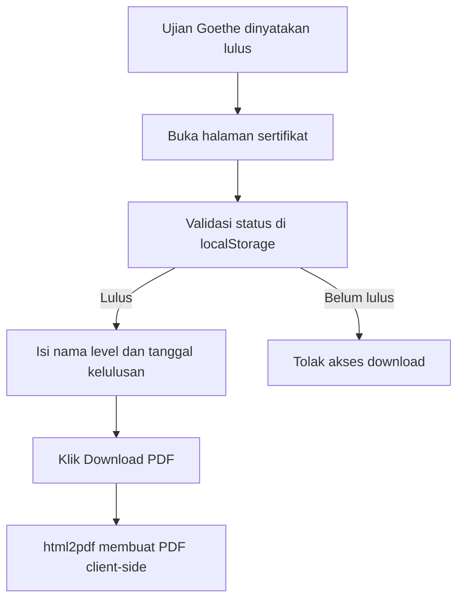
