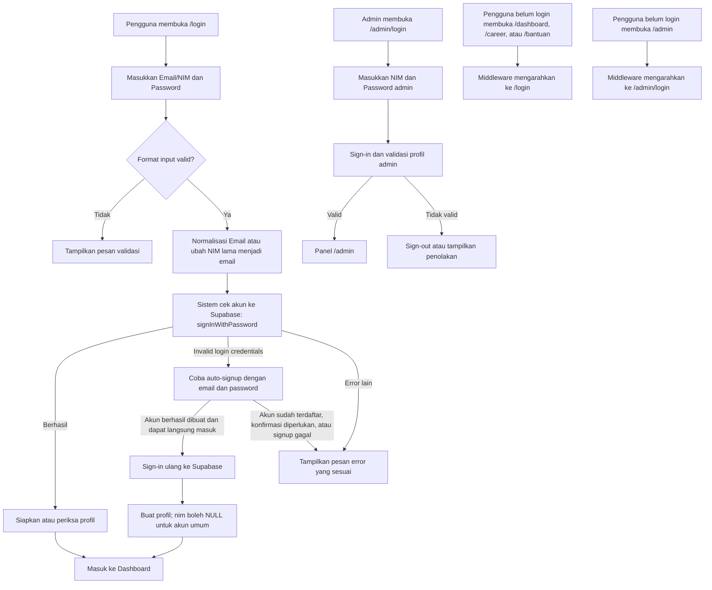
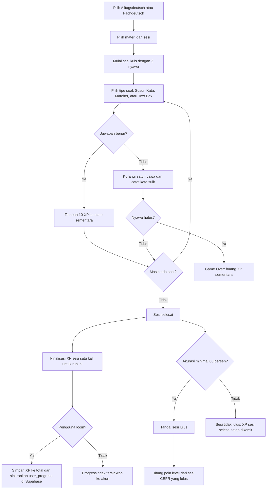
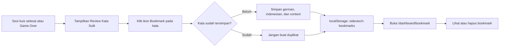
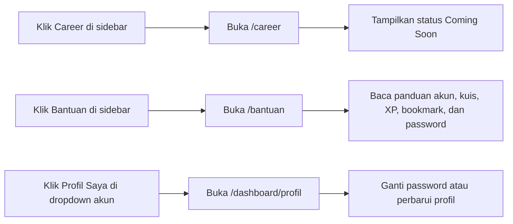
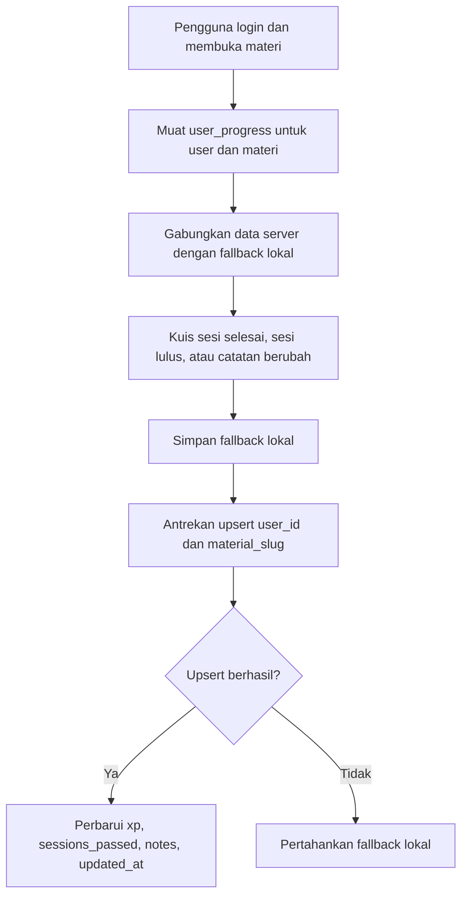

# siDeutsch — Alur Aplikasi

## Login, Auto-signup, dan Proteksi Rute

NIM lama tetap diterjemahkan ke alamat Supabase `NIM@student.sideutsch.com`; email pengguna umum dipakai langsung. Materi publik dapat dilihat tanpa login, tetapi dashboard dan rute privat memerlukan autentikasi.

## Kuis, XP, dan Progress

XP jawaban benar hanya disimpan sementara sampai sesi selesai; Game Over membuang XP yang belum dikomit. Guard finalisasi mencegah run yang sama disimpan dua kali. Implementasi belum mencegah XP didapat lagi dari replay sesi yang telah selesai, sehingga ini bukan pembatas replay lintas sesi.

## Review Kata Sulit dan Bookmark

Bookmark hanya disimpan di browser dan tidak disinkronkan ke Supabase.

## Career dan Bantuan

Halaman Career dan Bantuan berada di area login; kuis Career belum tersedia.

## Sinkronisasi Progress Supabase

`user_progress.sessions_passed` adalah array JSONB nomor sesi. RLS membatasi baris ke pemilik melalui `auth.uid() = user_id`.
