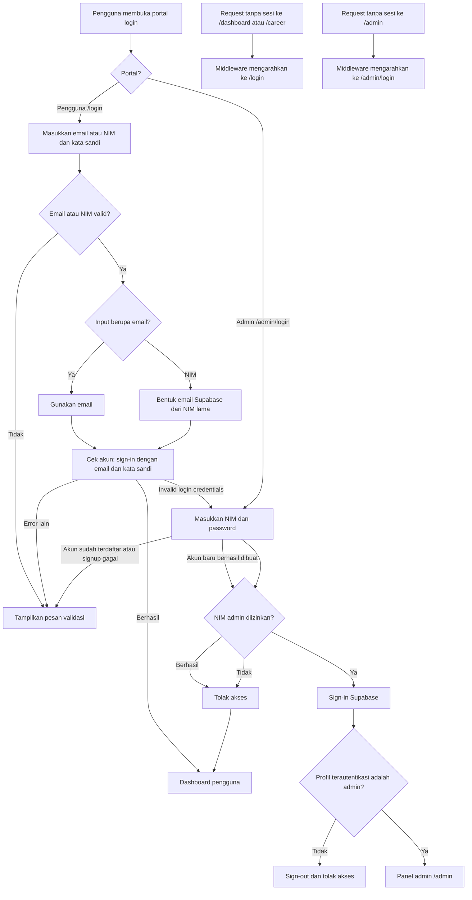
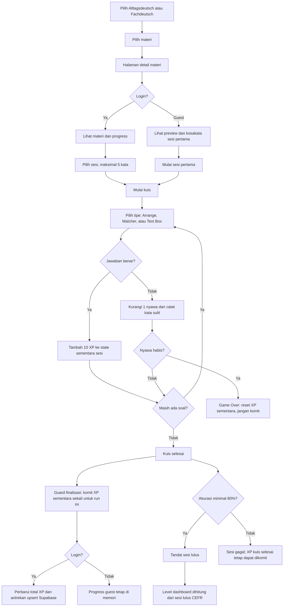
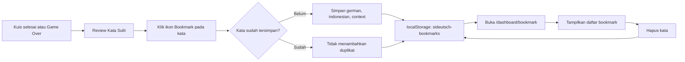
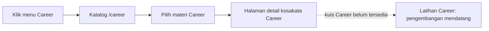
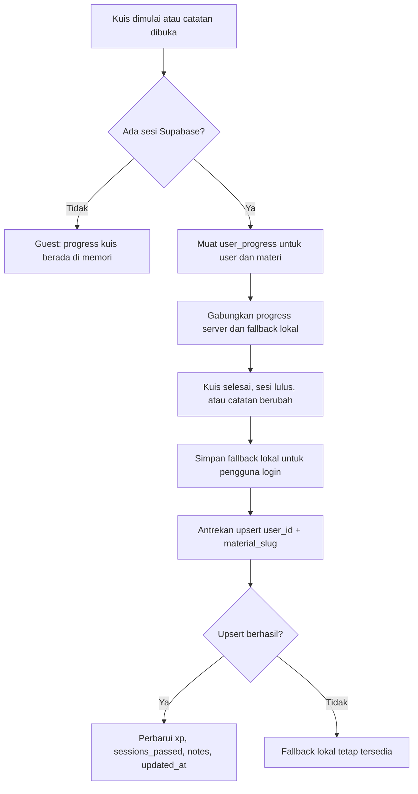
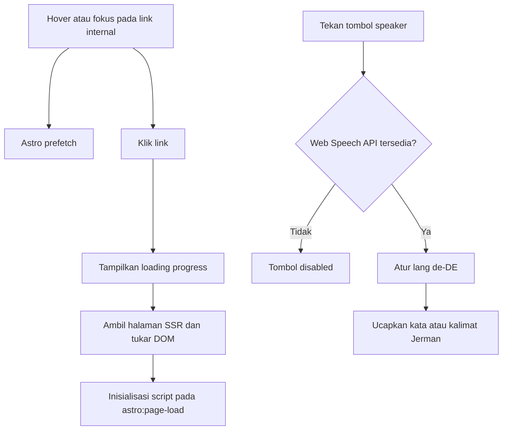

# siDeutsch — Alur Aplikasi

## Login dan Proteksi Rute

## Kuis Materi Utama, XP, dan Progress

XP dikomit setelah kuis selesai, tidak saat setiap jawaban benar. Game Over membuang XP sementara. Guard mencegah finalisasi ganda pada satu run, tetapi implementasi saat ini tidak membatasi perolehan XP saat pengguna memainkan ulang kuis yang sudah selesai.

## Review Kata Sulit dan Bookmark

Bookmark adalah data client-side di browser; bookmark tidak disimpan atau disinkronkan ke Supabase.

## Career

Collection Career dan halaman detail vocab telah tersedia dan rute `/career` dilindungi login. Kuis Career belum diimplementasikan pada codebase saat ini.

## Sinkronisasi Progress Supabase

`user_progress.sessions_passed` disimpan sebagai array JSONB nomor sesi. RLS membatasi baris ke pemilik melalui `auth.uid() = user_id`.

## Navigasi dan Audio

Prefetch membantu menghangatkan halaman internal, tetapi tidak menjamin SSR selesai sebelum klik. Audio bergantung pada Web Speech API dan voice Jerman browser/OS.
